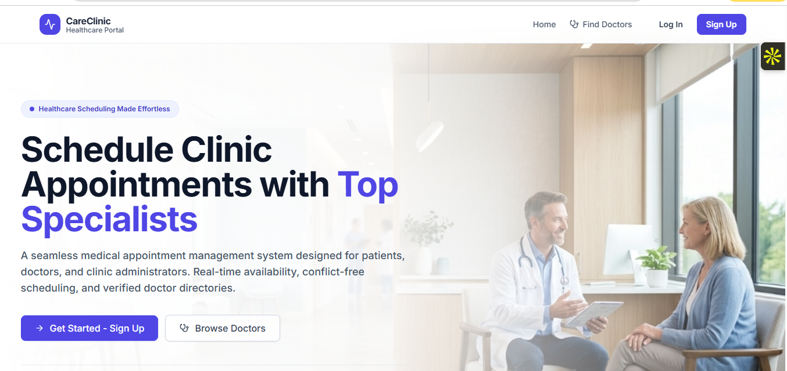
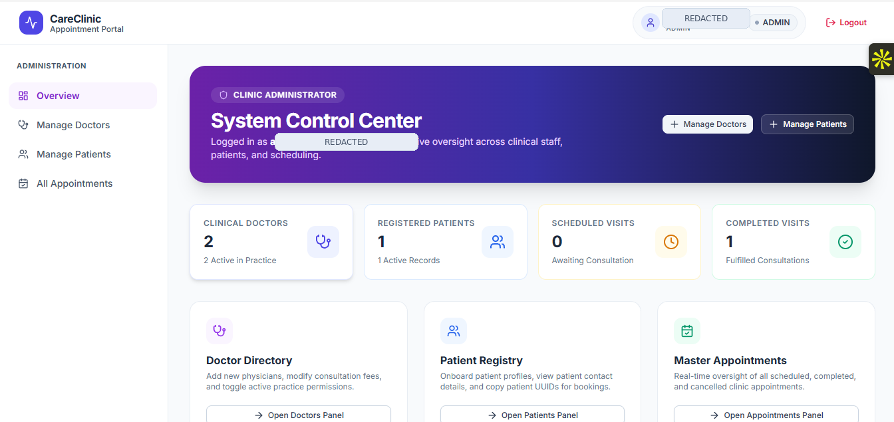
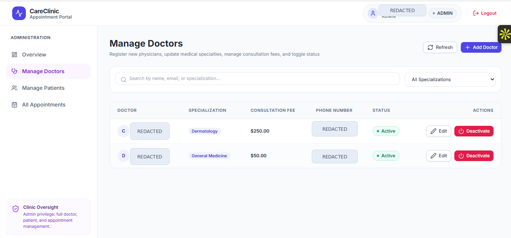
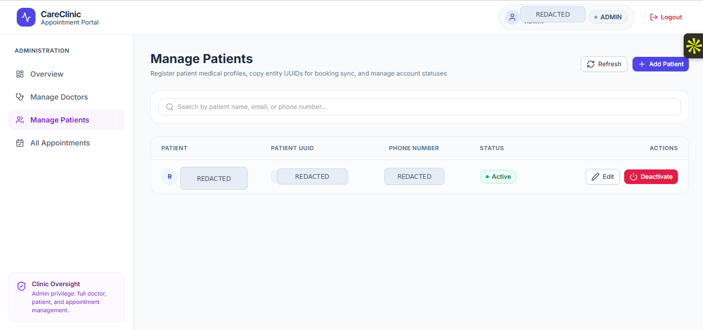
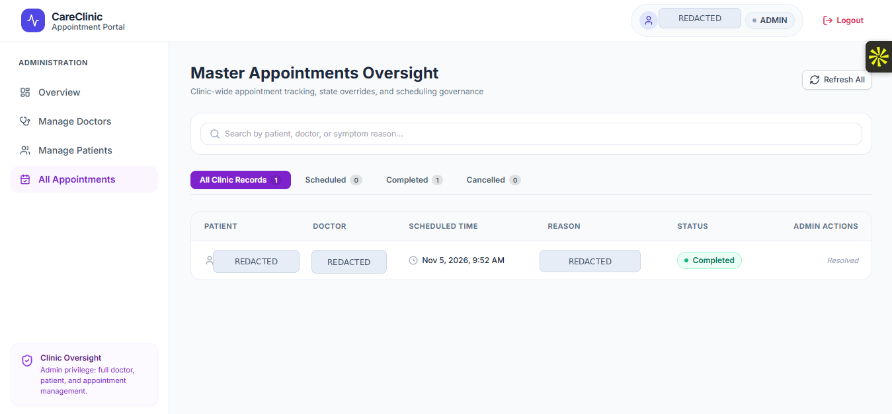
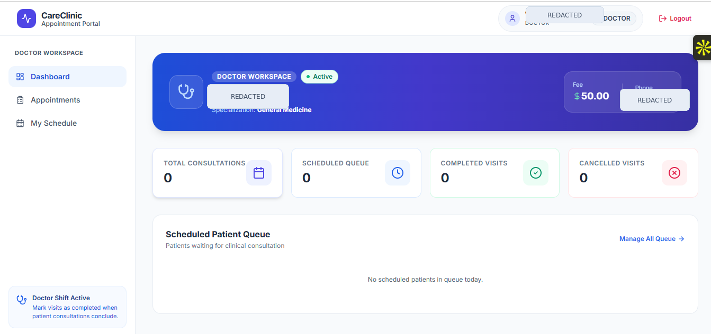
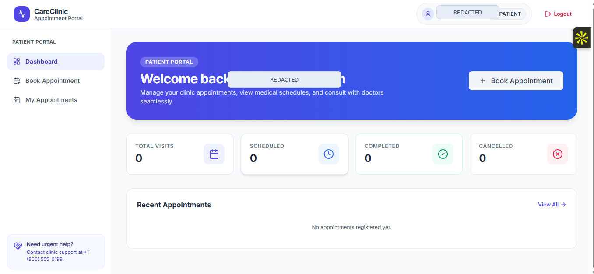
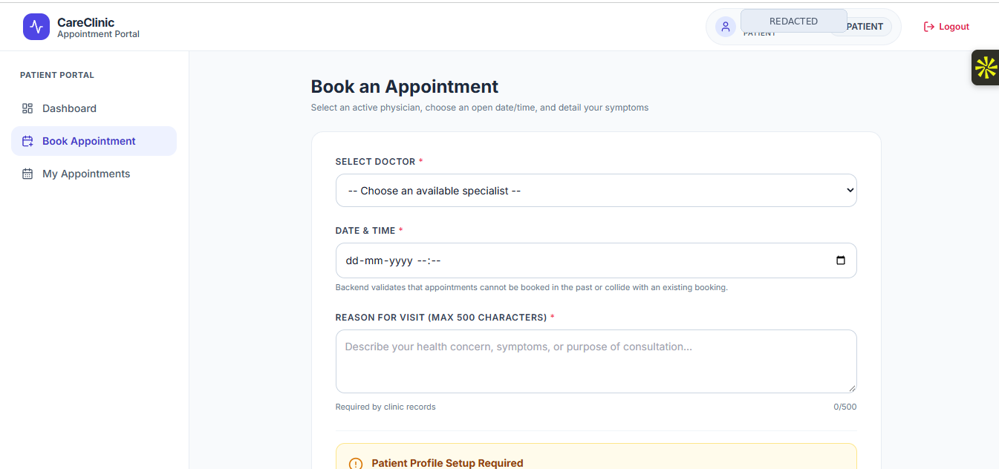
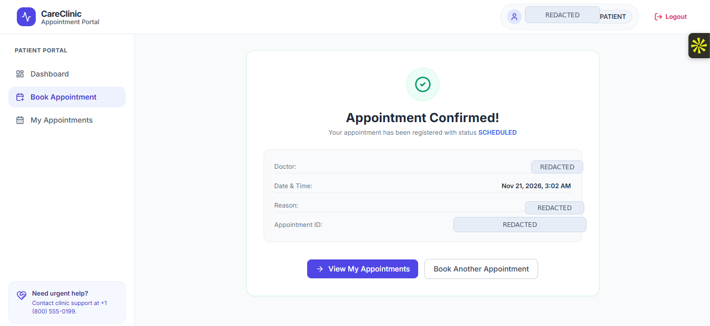

# 🏥 CareClinic — Healthcare Appointment Portal

A React-based healthcare appointment interface with dedicated portals for **Patients**, **Doctors**, and **Administrators**. The frontend connects to a Spring Boot backend for authentication, clinical record management, and appointment scheduling.

**Frontend:** React 18 · JavaScript · React Router 6 · Axios · Tailwind CSS · Vite  
**Backend:** Java · Spring Boot · Spring Security · REST APIs · Spring Data JPA · PostgreSQL

**Live frontend (deployment link):** [CareClinic](https://doctor-appointment-project0-fronten.vercel.app/)  
**Backend source:** [DoctorAppointment_Project0](https://github.com/Dibbyansh100/careclinic-backend)

## ✨ Features

- **Patient portal:** Patient dashboard, appointment booking and confirmation, appointment list.
- **Doctor workspace:** Doctor dashboard, consultation queue and schedule navigation.
- **Admin portal:** Clinic overview, doctor management, patient management, and appointment oversight.
- **Role-based navigation:** Separate application views for Administrator, Doctor, and Patient accounts.
- **Backend integration:** Connects to a Java Spring Boot REST API for application data and workflow actions.

## 📸 Application Screenshots

The following screenshots demonstrate the public website and the three role-based portals. **Personal and clinical details have been redacted** for public display. Click any image to open the full-size screenshot.

### Public Home Page

[](screenshots/01-home-page.png)

### Admin Portal

| Admin Overview | Manage Doctors |
| :---: | :---: |
| [](screenshots/02-admin-overview.png) | [](screenshots/03-admin-manage-doctors.png) |

| Manage Patients | All Appointments |
| :---: | :---: |
| [](screenshots/04-admin-manage-patients.png) | [](screenshots/05-admin-appointments.png) |

### Doctor Dashboard

[](screenshots/06-doctor-dashboard.png)

### Patient Portal

| Patient Dashboard | Book Appointment |
| :---: | :---: |
| [](screenshots/07-patient-dashboard.png) | [](screenshots/08-book-appointment.png) |

### Appointment Confirmation

[](screenshots/09-appointment-confirmation.png)


## 🛠️ Run Locally

### Prerequisites

- Node.js and npm
- The CareClinic Spring Boot backend running locally if you want to use the API-backed features

```bash
git clone https://github.com/Dibbyansh100/careclinic-frontend.git
cd DoctorAppointment_Project0_Frontend
npm install
```

Create a local `.env` file from `.env.example`, then configure the backend API base URL. To use the included Vite development proxy, leave `VITE_API_BASE_URL` empty and start the backend on port `8079`.

```env
VITE_API_BASE_URL=
```

Launch the frontend:

```bash
npm run dev
```

The development server is configured for **http://localhost:3000**. The Vite proxy forwards `/api` requests to **http://localhost:8079**.

To create a production build:

```bash
npm run build
```

## 🔐 Demo Data & Privacy

Screenshots are anonymized examples of application functionality; actual patient records, personal identifiers, and medical reasons should never be committed to a public repository. The UI shows roles and workflows, not a claim of production-grade medical compliance.
